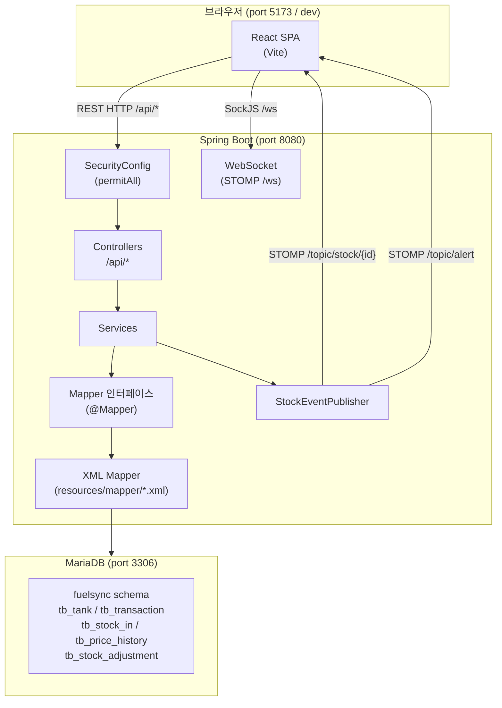
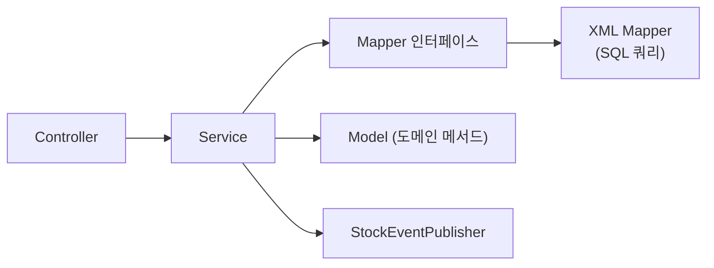
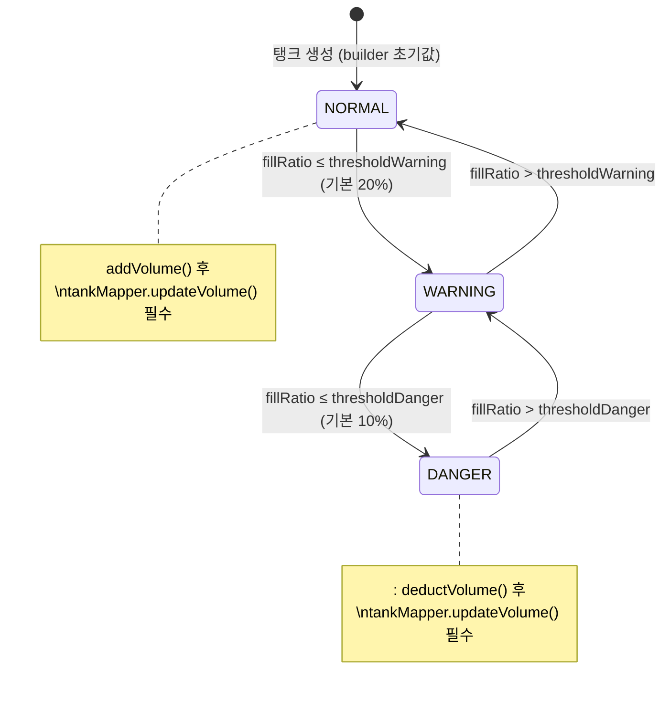
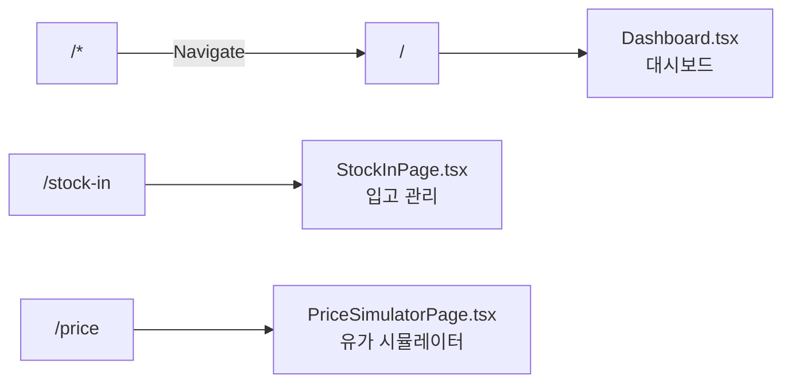
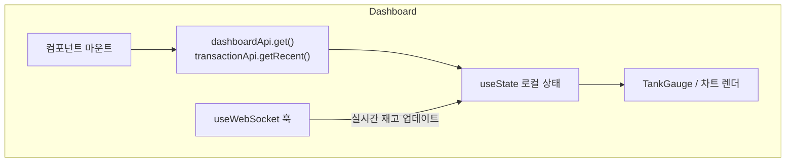
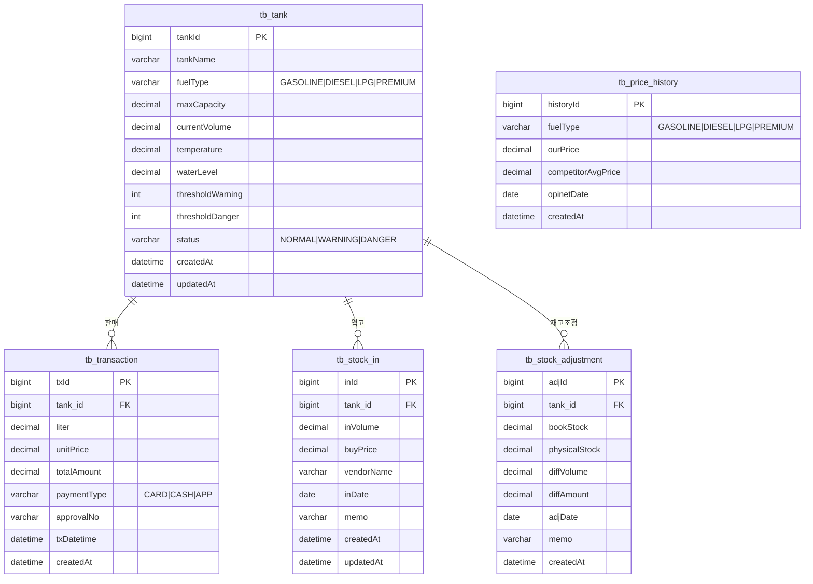
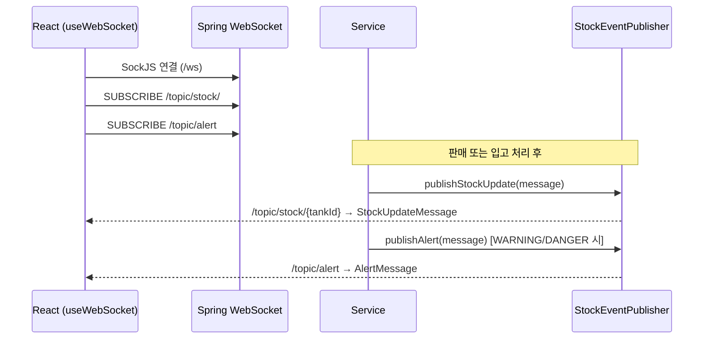
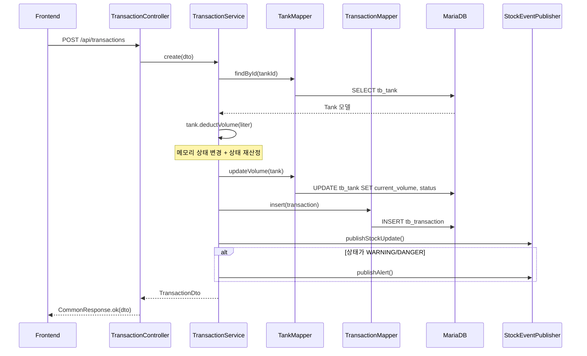
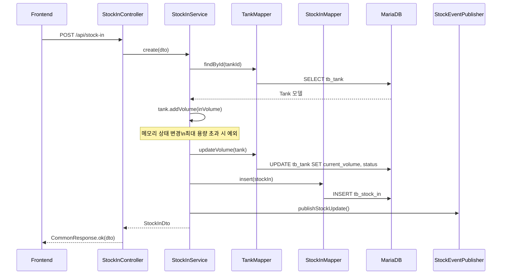

# FuelSync Pro – 소프트웨어 아키텍처 문서

> 신규 개발자를 위한 프로젝트 구조 가이드

---

## 목차

1. [프로젝트 개요](#1-프로젝트-개요)
2. [기술 스택](#2-기술-스택)
3. [시스템 전체 구조](#3-시스템-전체-구조)
4. [백엔드 아키텍처](#4-백엔드-아키텍처)
5. [프론트엔드 아키텍처](#5-프론트엔드-아키텍처)
6. [도메인 모델 (ERD)](#6-도메인-모델-erd)
7. [API 엔드포인트](#7-api-엔드포인트)
8. [실시간 데이터 흐름 (WebSocket)](#8-실시간-데이터-흐름-websocket)
9. [핵심 비즈니스 흐름](#9-핵심-비즈니스-흐름)
10. [개발환경 설정](#10-개발환경-설정)

---

## 1. 프로젝트 개요

**FuelSync Pro**는 주유소 연료 재고 및 유가를 실시간으로 관리하는 웹 애플리케이션입니다.

| 구분 | 내용 |
|------|------|
| 목적 | 탱크 재고 모니터링, 판매·입고 관리, 유가 시뮬레이션 |
| 대상 | 주유소 운영자 |
| 특징 | WebSocket 기반 실시간 탱크 상태 반영, MyBatis XML로 쿼리 관리 |

---

## 2. 기술 스택

### 백엔드

| 항목 | 기술 | 버전 |
|------|------|------|
| 언어 | Java | 17 |
| 프레임워크 | Spring Boot | 3.2.5 |
| DB 접근 | **MyBatis** (mybatis-spring-boot-starter) | 3.0.3 |
| 데이터베이스 | MariaDB | - |
| 실시간 | Spring WebSocket (STOMP) | - |
| 보안 | Spring Security + JJWT | 0.12.5 |
| 유틸리티 | Lombok | - |
| 빌드 | Maven | - |

### 프론트엔드

| 항목 | 기술 | 버전 |
|------|------|------|
| 언어 | TypeScript | - |
| UI 프레임워크 | React | 18 |
| 빌드 도구 | Vite | 5 |
| 스타일 | Tailwind CSS | 3 |
| 라우팅 | React Router | v6 |
| HTTP 클라이언트 | Axios | - |
| 차트 | ApexCharts | - |
| 실시간 | @stomp/stompjs + sockjs-client | - |
| 날짜 | dayjs | - |
| 전역상태 | Zustand (설치됨, 미활성) | - |

---

## 3. 시스템 전체 구조



> **개발 시 Vite proxy 사용**: `/api` 와 `/ws` 요청은 Vite dev server가 자동으로 `localhost:8080` 으로 포워딩합니다.

---

## 4. 백엔드 아키텍처

### 4-1. 패키지 구조

```
com.fuelsync
├── FuelsyncApplication.java          ← Spring Boot 진입점
├── config/
│   ├── SecurityConfig.java           ← CORS, 세션리스, 인증 설정
│   └── WebSocketConfig.java          ← STOMP 엔드포인트, 브로커 설정
├── common/
│   ├── response/CommonResponse.java  ← 통합 응답 래퍼
│   └── exception/
│       ├── FuelSyncException.java    ← 비즈니스 예외
│       └── GlobalExceptionHandler.java ← @RestControllerAdvice
├── websocket/
│   └── StockEventPublisher.java      ← 재고 변동 브로드캐스트
└── domain/
    ├── tank/          ← 탱크 관리
    ├── transaction/   ← 판매 내역
    ├── stockin/       ← 입고 관리
    ├── price/         ← 유가 이력 & 시뮬레이션
    ├── adjustment/    ← 재고 조정
    └── dashboard/     ← 대시보드 집계
```

각 도메인은 아래 레이어 구조를 따릅니다:

```
domain/<name>/
├── controller/   ← HTTP 요청 처리, CommonResponse 반환
├── service/      ← 비즈니스 로직, @Transactional
├── mapper/       ← @Mapper 인터페이스 (MyBatis)
├── model/        ← 순수 POJO 모델 (도메인 메서드 포함, JPA 어노테이션 없음)
└── dto/          ← 요청/응답 DTO

resources/mapper/
└── <Name>Mapper.xml  ← SQL 쿼리 파일 (XML)
```

### 4-2. 레이어 간 의존 방향



> **JPA와의 차이점**: MyBatis는 dirty checking이 없습니다. 모델 상태를 변경한 후 반드시 `mapper.update*()` 를 명시적으로 호출해야 DB에 반영됩니다.

```java
// ✅ MyBatis 올바른 패턴
tank.deductVolume(liter);      // 메모리 상태 변경
tankMapper.updateVolume(tank); // DB 명시 반영 ← 필수

// ❌ 잘못된 패턴 (JPA에서만 가능)
tank.deductVolume(liter);      // dirty checking 없음 → DB 미반영
```

### 4-3. 공통 응답 구조

모든 REST 응답은 `CommonResponse<T>`로 감쌉니다.

```json
{
  "success": true,
  "message": "OK",
  "data": { ... },
  "errorCode": null,
  "timestamp": "2026-04-25 19:00:00"
}
```

| 상황 | 사용 메서드 |
|------|------------|
| 성공 (데이터만) | `CommonResponse.ok(data)` |
| 성공 (메시지 포함) | `CommonResponse.ok("생성 완료", data)` |
| 실패 | `CommonResponse.fail("TANK_NOT_FOUND", "탱크를 찾을 수 없습니다")` |

### 4-4. MyBatis Mapper 구조

**Mapper 인터페이스** (`@Mapper` 어노테이션으로 자동 Bean 등록):

```java
@Mapper
public interface TankMapper {
    List<Tank> findAll();
    Optional<Tank> findById(@Param("tankId") Long tankId);
    void insert(Tank tank);
    void updateVolume(Tank tank);   // currentVolume + status 갱신
    void updateSensor(...);
}
```

**XML Mapper** (`resources/mapper/TankMapper.xml`):

```xml
<!-- INSERT: useGeneratedKeys로 PK 자동 주입 -->
<insert id="insert" useGeneratedKeys="true" keyProperty="tankId">
    INSERT INTO tb_tank (tank_name, fuel_type, ...) VALUES (#{tankName}, #{fuelType}, ...)
</insert>

<!-- 집계 쿼리: resultType="map" 후 Service에서 파싱 -->
<select id="findTodaySummaryByTank" resultType="map">
    SELECT COALESCE(SUM(liter), 0) AS soldLiter,
           COALESCE(SUM(total_amount), 0) AS revenue
    FROM tb_transaction
    WHERE tank_id = #{tankId} AND tx_datetime >= #{startOfDay}
</select>
```

**MyBatis 설정** (`application.yml`):

```yaml
mybatis:
  mapper-locations: classpath:mapper/*.xml
  type-aliases-package: com.fuelsync.domain
  configuration:
    map-underscore-to-camel-case: true   # snake_case → camelCase 자동 변환
```

### 4-5. Tank 도메인 상태 기계

탱크 상태는 잔량 비율(fillRatio)에 따라 `Tank.recalculateStatus()` 내부에서 자동 재산정됩니다. 상태 변경 후 `tankMapper.updateVolume(tank)`으로 반드시 DB에 저장해야 합니다.



---

## 5. 프론트엔드 아키텍처

### 5-1. 디렉토리 구조

```
src/
├── main.tsx          ← 앱 진입점
├── App.tsx           ← 라우터 & 네비게이션 쉘
├── index.css         ← Tailwind base
├── types/
│   └── index.ts      ← 전역 TypeScript 타입 정의
├── services/
│   └── api.ts        ← Axios 클라이언트 & API 함수 모음
├── hooks/
│   └── useWebSocket.ts ← STOMP 구독 커스텀 훅
├── pages/
│   ├── Dashboard.tsx         ← /
│   ├── StockInPage.tsx       ← /stock-in
│   └── PriceSimulatorPage.tsx ← /price
└── components/
    ├── tanks/
    │   └── TankGauge.tsx     ← 탱크 잔량 게이지 UI
    └── common/
        └── StatusBadge.tsx   ← NORMAL/WARNING/DANGER 뱃지
```

### 5-2. 라우팅



### 5-3. 데이터 흐름 (페이지 레벨)



### 5-4. API 클라이언트 구조

`services/api.ts` 에 도메인별 API 객체가 정의됩니다.

```
api.ts
├── dashboardApi   → GET /api/dashboard
├── tankApi        → GET|POST|PATCH /api/tanks
├── transactionApi → GET|POST /api/transactions
├── stockInApi     → GET|POST /api/stock-in
└── priceApi       → GET|POST /api/price
```

> Axios 인터셉터: 요청 시 `localStorage`의 JWT 토큰을 `Authorization: Bearer` 헤더로 자동 첨부합니다.

---

## 6. 도메인 모델 (ERD)



> `tb_price_history` 는 탱크와 직접 연관되지 않고 `FuelType` 기준으로 관리합니다.

### 모델 클래스와 테이블 매핑

| 모델 클래스 | 테이블 | XML Mapper |
|------------|--------|------------|
| `domain/tank/model/Tank.java` | `tb_tank` | `TankMapper.xml` |
| `domain/transaction/model/Transaction.java` | `tb_transaction` | `TransactionMapper.xml` |
| `domain/stockin/model/StockIn.java` | `tb_stock_in` | `StockInMapper.xml` |
| `domain/price/model/PriceHistory.java` | `tb_price_history` | `PriceHistoryMapper.xml` |
| `domain/adjustment/model/StockAdjustment.java` | `tb_stock_adjustment` | `StockAdjustmentMapper.xml` |

---

## 7. API 엔드포인트

### 대시보드

| Method | Path | 설명 |
|--------|------|------|
| GET | `/api/dashboard` | 오늘 요약 + 탱크 목록 + 연료별 집계 |

### 탱크

| Method | Path | 설명 |
|--------|------|------|
| GET | `/api/tanks` | 전체 탱크 목록 (쿼리: `fuelType`) |
| GET | `/api/tanks/{tankId}` | 탱크 단건 조회 |
| GET | `/api/tanks/attention` | 경고/위험 탱크 목록 |
| POST | `/api/tanks` | 탱크 등록 |
| PATCH | `/api/tanks/{tankId}/sensor` | 센서 데이터 업데이트 |

### 판매

| Method | Path | 설명 |
|--------|------|------|
| GET | `/api/transactions` | 기간별 조회 (`from`, `to`) |
| GET | `/api/transactions/recent` | 최근 1시간 판매 내역 |
| POST | `/api/transactions` | 판매 등록 |

### 입고

| Method | Path | 설명 |
|--------|------|------|
| GET | `/api/stock-in` | 기간별 조회 (`from`, `to`) |
| GET | `/api/stock-in/tank/{tankId}` | 탱크별 입고 이력 |
| POST | `/api/stock-in` | 입고 등록 |

### 유가

| Method | Path | 설명 |
|--------|------|------|
| GET | `/api/price/history` | 유가 이력 (`fuelType`, `from`, `to`) |
| POST | `/api/price/history` | 유가 이력 등록 |
| POST | `/api/price/simulate` | 유가 시뮬레이션 |

### 재고 조정

| Method | Path | 설명 |
|--------|------|------|
| GET | `/api/adjustments` | 기간별 조회 (`from`, `to`) |
| GET | `/api/adjustments/tank/{tankId}` | 탱크별 조정 이력 |
| POST | `/api/adjustments` | 재고 조정 등록 |

---

## 8. 실시간 데이터 흐름 (WebSocket)



**WebSocket 메시지 타입**

```typescript
// 재고 변동 메시지 (프론트엔드 types/index.ts)
interface StockUpdateMessage {
  tankId: number;
  tankName: string;
  fuelType: FuelType;
  currentVolume: number;
  maxCapacity: number;
  fillRatio: number;
  status: TankStatus;
}
```

---

## 9. 핵심 비즈니스 흐름

### 판매 등록 흐름

JPA와의 핵심 차이: `tankMapper.updateVolume(tank)` 명시 호출이 필수입니다.



### 입고 등록 흐름



---

## 10. 개발환경 설정

### 사전 준비

- Java 17+
- Node.js 18+
- MariaDB (fuelsync 스키마 및 테이블 사전 생성 필요)
- Maven 3.x (또는 프로젝트 내 `mvnw` Wrapper 사용)

### DB 설정

`application.yml` 기준:

```
Host:     localhost:3306
Database: fuelsync
User:     fuelsync
Password: <password>
```

> MyBatis는 DDL 자동 생성 기능이 없습니다.  
> **테이블은 별도 DDL 스크립트로 먼저 생성해야 합니다.**

### 쿼리 수정 방법

SQL을 수정하려면 `backend/src/main/resources/mapper/` 안의 XML 파일만 편집하면 됩니다.

```
resources/mapper/
├── TankMapper.xml            ← 탱크 CRUD + 상태 갱신 쿼리
├── TransactionMapper.xml     ← 판매 조회/등록 + 집계 쿼리
├── StockInMapper.xml         ← 입고 조회/등록 + 평균 단가 쿼리
├── PriceHistoryMapper.xml    ← 유가 이력 조회/등록
└── StockAdjustmentMapper.xml ← 재고 조정 조회/등록
```

### 백엔드 실행

```bash
cd backend
mvn spring-boot:run
# → http://localhost:8080
```

### 프론트엔드 실행

```bash
cd frontend
npm install
npm run dev
# → http://localhost:5173
```

Vite 개발 서버가 `/api/*` 와 `/ws` 요청을 `localhost:8080` 으로 자동 프록시합니다.

### 주요 미구현 사항 (인수인계)

| 항목 | 상태 | 비고 |
|------|------|------|
| JWT 인증 필터 | 미구현 | `SecurityConfig`가 현재 `permitAll` |
| `/login` 라우트 | 미구현 | 401 시 리다이렉트되나 화면 없음 |
| Zustand 전역 스토어 | 미구현 | 의존성만 설치됨 (`src/store/` 없음) |
| 테스트 코드 | 미작성 | `src/test` 디렉토리 없음 |
| Docker / 배포 설정 | 미작성 | Dockerfile 없음 |
